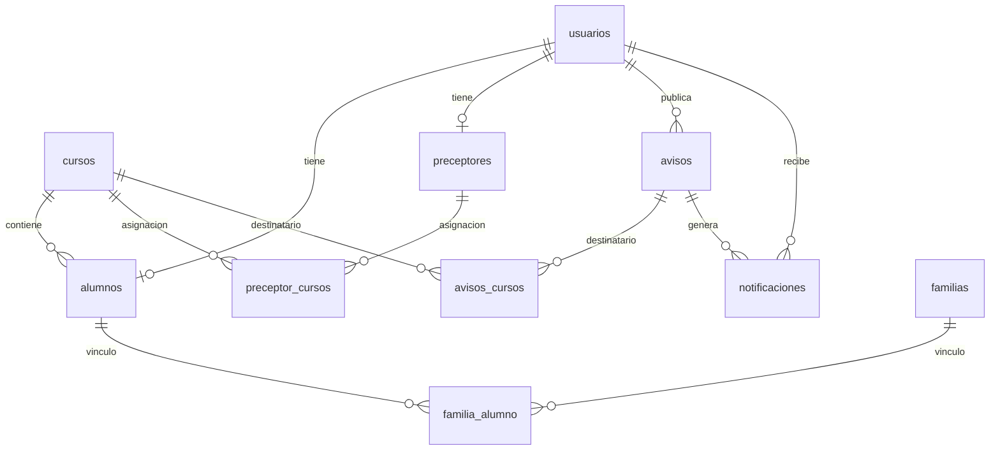

# Manual Técnico - Sistema de Avisos Escolares

Documentación para desarrolladores y quienes mantienen el sistema. Para el uso por parte de la comunidad educativa, ver `README.md`.

> **Origen de la información:** este manual se basa en el informe técnico del código actual del proyecto. Los puntos marcados como **⚠️ Brecha** indican diferencias entre el comportamiento requerido y lo que hoy hace el código.

## Contenido

1. [Visión general y stack](#1-visión-general-y-stack)
2. [Estructura del proyecto](#2-estructura-del-proyecto)
3. [Base de datos](#3-base-de-datos)
4. [Backend: API y validaciones](#4-backend-api-y-validaciones)
5. [Autenticación y roles](#5-autenticación-y-roles)
6. [Correo electrónico](#6-correo-electrónico)
7. [Frontend](#7-frontend)
8. [Variables de entorno](#8-variables-de-entorno)
9. [Instalación y despliegue](#9-instalación-y-despliegue)
10. [Brechas entre requisitos y código](#10-brechas-entre-requisitos-y-código)
11. [Seguridad: puntos a mejorar](#11-seguridad-puntos-a-mejorar)
12. [Tests y documentación](#12-tests-y-documentación)

---

## 1. Visión general y stack

Aplicación web de avisos escolares: los preceptores y regentes publican avisos, y los alumnos los consultan en la plataforma y los reciben por correo.

| Componente | Tecnología | Versión (declarada / lockfile) |
|---|---|---|
| Frontend | React + React DOM | `^19.2.8` / `19.3.0` |
| Bundler | Vite | `^8.3.0` / `8.3.0` |
| Backend | Node.js + Express | Express `^5.2.1` / `5.2.1` |
| Base de datos | MySQL (InnoDB, `utf8mb4`, `utf8mb4_0900_ai_ci`) | No fijada |
| Driver SQL | `mysql2` | `^3.24.4` |
| JWT | `jsonwebtoken` | `^9.0.3` |
| Contraseñas | `bcryptjs` | `^3.0.3` |
| Correo | Nodemailer | `^10.2.1` |

No hay una versión de Node.js fijada en el proyecto. Vite 8 requiere Node **20.19+ o 22.12+**.

---

## 2. Estructura del proyecto

```text
avisos-escolares/
├── backend/
│   ├── adapters/
│   │   ├── dataAdapter.js       # contrato del adaptador
│   │   ├── index.js             # selecciona el proveedor de datos
│   │   └── mysqlAdapter.js      # consultas, transacciones y lógica de datos
│   ├── certs/ca.pem             # CA para conexión MySQL con SSL
│   ├── db.js                    # pool, compatibilidad de esquema y SSL
│   ├── emailService.js          # Nodemailer y plantillas de correo
│   ├── server.js                # API Express, JWT y rutas
│   ├── .env.example
│   └── package.json
├── database/
│   └── avisos_escolares.sql     # esquema + datos de ejemplo
├── src/
│   ├── App.jsx                  # estado principal y selección de panel por rol
│   ├── components/{common,notices}/
│   ├── data/mockData.js         # nombres de roles y categorías
│   ├── pages/                   # LoginPage, AlumnoDashboard, PreceptorDashboard, RegenteDashboard
│   ├── services/                # apiClient, authService, noticeService, cursos
│   ├── styles/
│   └── images/
├── index.html
├── vite.config.js
├── package.json
├── README.md
└── MANUAL_DE_USUARIO.md
```

El backend usa un **patrón adaptador**: `server.js` no habla con MySQL directamente, sino a través de `adapters/`. El proveedor se elige con `DATA_PROVIDER`. Hoy solo `mysql` está implementado; `nexus` figura como previsto pero lanza error.

---

## 3. Base de datos

El archivo `database/avisos_escolares.sql` incluye DDL **y datos de ejemplo**.

> ⚠️ **Advertencia:** el script elimina y recrea las tablas que lista. No ejecutarlo sobre una base con datos que se quieran conservar.

### Tablas

| Tabla | Columnas |
|---|---|
| `usuarios` | `id_usuario` PK, `nombre`, `apellido`, `email` UNIQUE, `contrasena`, `rol`, `turno` |
| `cursos` | `id_curso` PK, `anio`, `division`, `especialidad`, `turno` |
| `alumnos` | `id_alumno` PK, `id_usuario` FK, `id_curso` FK |
| `preceptores` | `id_preceptor` PK, `id_usuario` FK |
| `preceptor_cursos` | `id_preceptor` PK/FK, `id_curso` PK/FK |
| `familias` | `id_familia` PK, `nombre`, `apellido`, `email` |
| `familia_alumno` | `id_familia` PK/FK, `id_alumno` PK/FK |
| `avisos` | `id_aviso` PK, `titulo`, `contenido`, `fecha_publicacion`, `tipo`, `id_usuario` FK, `notificar_familias`, `prioridad` |
| `avisos_cursos` | `id_aviso` PK/FK, `id_curso` PK/FK |
| `notificaciones` | `id_notificacion` PK, `id_aviso` FK, `id_usuario` FK, `leido`, `fecha_lectura` |

Las tablas puente (`preceptor_cursos`, `familia_alumno`, `avisos_cursos`) usan claves primarias compuestas. **No hay restricciones `CHECK`** que validen rol, prioridad o turno: esas validaciones dependen del backend.

### Diagrama de relaciones



### Cómo se modelan los destinatarios

- **Aviso → cursos:** relación muchos a muchos mediante `avisos_cursos`.
- **Preceptor → cursos:** `preceptores.id_usuario` enlaza con `usuarios`; `preceptor_cursos` asigna cursos.
- **Lectura:** `notificaciones` guarda por usuario y aviso si fue leído y cuándo.
- Hoy, un aviso general (toda la institución) **se representa sin filas en `avisos_cursos`** (ver [brechas](#10-brechas-entre-requisitos-y-código)).

### Valores de `cursos.turno`

En el dump aparecen únicamente **`Mañana`** y **`Tarde`**:

| `id_curso` | Curso | Especialidad | Turno |
|---:|---|---|---|
| 1 | 1° 1 | — | Mañana |
| 2 | 2° 2 | — | Tarde |
| 3 | 3° 1 | Automotores | Tarde |
| 4 | 4° 2 | Computación | Mañana |
| 5 | 5° 1 | Automotores | Tarde |
| 6 | 6° 2 | Computación | Mañana |

Esto refleja el dump versionado, no necesariamente la base desplegada. No hay cursos de turno **Noche** en los datos de ejemplo, aunque el código lo contempla.

### Tablas de ausencias

El dump elimina tablas antiguas (`horarios`, `ausencias`, `materias`, `profesores`) y no las recrea. **No existe hoy un modelo de datos de ausencias docentes.**

---

## 4. Backend: API y validaciones

Rutas en `backend/server.js`; consultas y transacciones principalmente en `adapters/mysqlAdapter.js`.

| Método y ruta | Función | Acceso actual |
|---|---|---|
| `GET /api/test` | Estado y proveedor de datos | Público |
| `GET /api/health` | Health check | Público |
| `POST /api/login` | Verifica credenciales, devuelve JWT | Público |
| `POST /api/usuarios/cambiar-contrasena` | Cambia contraseña | JWT: alumno, preceptor, regente |
| `GET /api/cursos` | Lista cursos | Público |
| `GET /api/avisos` | Lista avisos | Público |
| `GET /api/avisos/autor/:id_usuario` | Avisos de un autor | Público |
| `POST /api/avisos` | Publica aviso | JWT: preceptor o autoridad |
| `PUT /api/avisos/:id_aviso` | Edita aviso | JWT: preceptor o autoridad |
| `DELETE /api/avisos/:id_aviso` | Elimina aviso | JWT: preceptor o autoridad |
| `GET /api/notificaciones/:id_usuario` | Avisos leídos de un usuario | Público |
| `POST /api/notificaciones/toggle` | Alterna lectura de un aviso | JWT |
| `POST /api/notificaciones/marcar-todas` | Marca avisos como leídos | JWT |

### Validaciones al crear un aviso (`POST /api/avisos`)

1. `titulo` y `contenido` son obligatorios.
2. Prioridades aceptadas: `baja`, `media`, `alta`, `normal`. Si no se envía, se usa `baja`.
3. **Preceptor:** no puede usar `alta`. No puede elegir toda la escuela. El backend obtiene sus cursos con `getCursosByPreceptor(id_usuario)` y compara con el destinatario enviado.
4. **Autoridad (regente):** solo puede publicar con destinatario `Todos`, `Turno Mañana`, `Turno Tarde` o `Turno Noche`, no cursos individuales.
5. La identidad del autor se toma del JWT, no del `id_usuario` que envíe el navegador.

### Flujo de creación (transacción MySQL)

1. Insertar en `avisos`.
2. Resolver cursos destinatarios e insertar en `avisos_cursos` cuando corresponda.
3. Crear notificaciones internas para los alumnos destinatarios.
4. Si `notificar_familias` está activo, consultar los familiares de esos alumnos.
5. Tras el commit, disparar los correos sin esperar (ver [sección 6](#6-correo-electrónico)).

### Edición (`PUT /api/avisos/:id_aviso`)

Se revalida el rango de prioridades. Si quien edita no es autoridad, se verifica que sea el autor y que no asigne prioridad `alta`. **No se revalida la asignación del curso al preceptor** como sí ocurre al crear (ver [brechas](#10-brechas-entre-requisitos-y-código)).

---

## 5. Autenticación y roles

- `POST /api/login` recibe `email` y `contrasena`, busca al usuario y compara la contraseña.
- Se aceptan contraseñas en texto plano heredadas o hashes bcrypt. Al cambiar contraseña se guarda con bcrypt (10 rondas).
- Si el login es válido, se firma un JWT con `id_usuario`, `email` y `rol`. Vigencia por defecto: **8 horas**.
- El frontend guarda el token en `localStorage` (`avisos_auth_token`) y el usuario en `avisos_current_user`. Al cerrar sesión se borran ambos.
- `apiClient.js` agrega `Authorization: Bearer <token>` a cada petición cuando hay token.
- Un middleware verifica firma y expiración; otro compara el rol contra los permitidos por ruta.

---

## 6. Correo electrónico

Se usa **Nodemailer por SMTP**. La plantilla de ejemplo apunta a Gmail (`smtp.gmail.com`, puerto 587), pero host, puerto y credenciales son configurables, por lo que se puede usar otro proveedor.

**Destinatarios de los correos**

- **Alumnos destinatarios del aviso:** reciben correo a su cuenta.
- **Familias:** solo si el aviso se creó con `notificar_familias`.
- Las direcciones se deduplican por email en minúsculas y se envía un correo individual a cada una.

**Comportamiento operativo**

- El envío es **asíncrono, sin esperar** el resultado: la respuesta de creación no confirma que el correo se entregó. Los errores quedan solo en logs.
- Si faltan credenciales SMTP, Nodemailer usa un transporte JSON de simulación (no envía nada).

> Eliminar la opción "notificar a familias" del formulario del preceptor **no implica eliminar** `emailService.js` ni el envío a alumnos.

---

## 7. Frontend

`App.jsx` renderiza el panel según `currentUser.rol`:

| Rol | Panel | Funciones |
|---|---|---|
| Alumno | `AlumnoDashboard.jsx` | Avisos de su curso/turno, filtros, no leídos, marcar como leído |
| Preceptor | `PreceptorDashboard.jsx` | Avisos de sus divisiones y propios; crear, editar y eliminar |
| Regente / autoridades | `RegenteDashboard.jsx` | Avisos institucionales y propios; crear, editar y eliminar |

El inicio de sesión está en `LoginPage.jsx`. No hay paneles para docente o secretaría. No hay pantallas ni servicios específicos de ausencias docentes.

Servicios que consumen la API: `apiClient.js`, `authService.js`, `noticeService.js`. La URL base sale de `VITE_API_URL` (por defecto `http://localhost:3002/api`).

---

## 8. Variables de entorno

Referencia: `backend/.env.example`. 

| Variable | Uso |
|---|---|
| `DB_HOST`, `DB_PORT` | Host y puerto MySQL (puerto por defecto 3306) |
| `DB_USER`, `DB_PASSWORD`, `DB_NAME` | Credenciales y base |
| `DATA_PROVIDER` | Adaptador de datos (`mysql` implementado) |
| `DB_SSL_MODE` | Uso de SSL en MySQL |
| `DB_CA_PATH` / `DB_CA_CERT` | Certificado CA por ruta o como texto |
| `DB_SSL_REJECT_UNAUTHORIZED` | Validación del certificado |
| `JWT_SECRET` | Secreto de firma JWT |
| `JWT_EXPIRES_IN` | Vigencia del token (por defecto `8h`) |
| `SMTP_HOST`, `SMTP_PORT`, `SMTP_SECURE` | Servidor SMTP |
| `SMTP_USER`, `SMTP_PASS` | Credenciales SMTP |
| `EMAIL_FROM` | Remitente |
| `PORT` | Puerto HTTP del backend (por defecto 3002) |
| `VITE_API_URL` | URL base de la API para el frontend |

En local, el backend desactiva SSL para `localhost` salvo que se fuerce; para hosts remotos intenta usar SSL (`adapters/index.js`, `db.js`).

---

## 9. Instalación y despliegue

### Desarrollo local

```bash
npm install
cd backend && npm install && cd ..
```

Crear `backend/.env` desde `backend/.env.example`, configurar MySQL e importar `database/avisos_escolares.sql`. Luego:

```bash
npm run dev            # frontend y backend juntos
npm run dev:backend    # solo backend
npm run dev:frontend   # solo frontend (Vite, puerto 5173)
```

Otros scripts: `npm run build` (compila el frontend) y `npm run lint`.

### Base de datos y migraciones

- No hay herramienta formal de migraciones.
- Al iniciar, `db.js` verifica el esquema y puede **agregar `avisos.prioridad`** si falta, y crear una columna virtual `cursos.anio` si encuentra `cursos.año`.
- El README original menciona Aiven (importación con DBeaver) y opciones como Render o AWS, pero **no hay Dockerfile, manifiesto ni URL pública documentada** en el repositorio.

---

## 10. Brechas entre requisitos y código

Diferencias detectadas entre lo acordado para el sistema y lo que hace hoy el código. Es la lista de trabajo pendiente.

| # | Requisito | Estado en el código | Acción sugerida |
|---|---|---|---|
| 1 | Preceptor: prioridades solo **Normal o Media** | El backend acepta `baja`, `media`, `alta`, `normal` y usa `baja` por defecto; solo bloquea `alta` al preceptor | Definir si `baja` existe como valor válido y restringir al preceptor a `normal` y `media` |
| 2 | Preceptor: sin notificación a familias | El backend sigue aceptando `notificar_familias` | Ignorar o rechazar `notificar_familias` cuando el rol es preceptor |
| 3 | Preceptor: validar curso asignado también al **editar** | `PUT` no vuelve a validar la asignación del curso | Replicar la validación de `POST` en `PUT` |
| 4 | Regente: "Toda la escuela" asocia el aviso a **todos los cursos** | Un aviso general se guarda **sin filas** en `avisos_cursos` | Crear filas para todos los cursos al publicar, o ajustar el requisito y las consultas |
| 5 | Regente: turnos `Mañana`, `Tarde`, `Noche` resueltos por `cursos.turno` | Datos con `Mañana` y `Tarde`; destinatarios con prefijo `Turno ...`; sin cursos de Noche | Verificar valores reales en la base y mapear `Turno X` → `cursos.turno` |
| 6 | Regente: "Mis avisos" solo con avisos de regentes | No hay filtro por rol del autor documentado | Filtrar por rol del autor y excluir avisos de preceptores |
| 7 | Preceptor informa ausencias docentes mediante aviso | No existe modelo ni pantalla específica de ausencias | Definir categoría o tipo de aviso para ausencias y su formulario (horario, docente) |
| 8 | Documentación | README y manual de usuario originales describían funciones de ausencias y secretaría que el código no tiene | Mantener alineadas las tres documentaciones |

### Verificación pendiente

- [ ] Confirmar los valores reales de `cursos.turno` en la base desplegada.
- [ ] Confirmar si `avisos` y `avisos_cursos` alcanzan para los puntos 4 y 6 sin agregar tablas ni columnas (para el 6 puede bastar el rol del autor vía `usuarios`).
- [ ] Decidir si el regente conserva la notificación a familias.

---

## 11. Seguridad: puntos a mejorar

- **`JWT_SECRET` por defecto:** si no se define, el servidor usa un secreto escrito en el código. En cualquier despliegue real debe configurarse un valor privado y fuerte.
- **Endpoints públicos con datos de usuarios:** `GET /api/avisos`, `GET /api/avisos/autor/:id_usuario`, `GET /api/notificaciones/:id_usuario` y `GET /api/cursos` no exigen JWT. Evaluar protegerlos y filtrar por rol/curso.
- **Contraseñas en texto plano:** el adaptador acepta contraseñas heredadas sin hash y el dump de ejemplo las incluye. Migrar todas a bcrypt y no usar esos datos en producción.
- **Token en `localStorage`:** expuesto ante XSS; considerar cookies `HttpOnly` si el riesgo lo justifica.
- **Dump SQL:** contiene datos de muestra y credenciales de demostración; protegerlo y no reutilizarlo en producción.

---

## 12. Tests y documentación

- No hay suite de tests en el frontend. El script `test` del backend es un placeholder que termina con error.
- No hay migraciones versionadas ni seeds separados; el SQL incluye los datos de ejemplo.
- Documentación existente: `README.md` y `MANUAL_DE_USUARIO.md`. Contrastarlas con el código antes de darlas por vigentes.